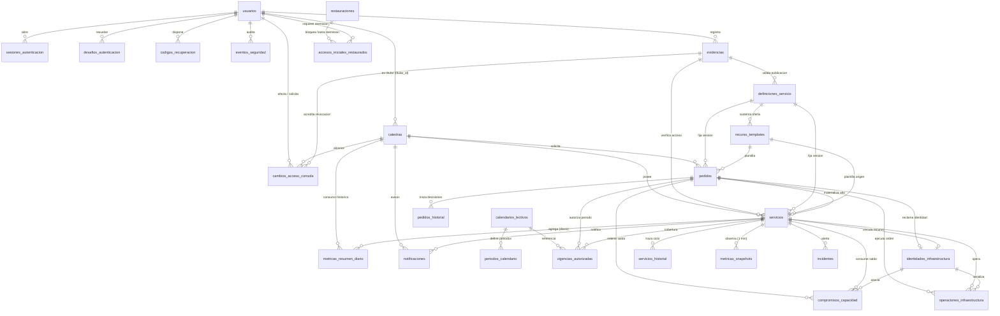

# Modelo y Diagrama de Base de Datos — Portal NAP (Feature 009)

Este documento describe el esquema relacional definitivo del portal de gestión de la Nube Académica Práctica (NAP) sobre **PostgreSQL 16** y **SQLAlchemy 2.0**, convergente tanto para instalaciones nuevas (`fresh`) como para actualizaciones (`upgrade`) hasta la revisión de Alembic **`009_14_restauracion`**.

Referencias relacionadas: [Especificación 009](../specs/009-remediar-hallazgos-cierre/spec.md) · [Modelo de datos detallado](../specs/009-remediar-hallazgos-cierre/data-model.md) · [Contratos de API](../specs/009-remediar-hallazgos-cierre/contracts/operations.md).

---

## 1. Diagrama Entidad-Relación (Mermaid)

---

## 2. Dominios y Tablas del Esquema

### 2.1. Autenticación, Sesiones, Segundo Factor y Consola Nativa

| Tabla | Clave Primaria | Claves Foráneas e Índices Únicos | Propósito e Invariantes Clave |
|---|---|---|---|
| `usuarios` | `id` (INTEGER) | `UNIQUE(username)`, `UNIQUE(email)`, `UNIQUE(identidad_consola)` | Usuarios de rol `admin` o `catedra`. Conserva `password_hash`, `debe_cambiar_password`, `totp_habilitado`, `totp_secret_encrypted` (Fernet versionado), `totp_last_step`, `auth_version` (`>= 1`), `recovery_generation` (`>= 0`), `revision_admin` (`>= 1`), `inventario_consola` (`desconocido`, `sin_identidad`, `asignada`) y `habilitacion_inconsistente`. La columna heredada `totp_secret` en texto plano fue retirada en `009_13`. |
| `sesiones_autenticacion` | `id` (VARCHAR/UUID) | `usuario_id -> usuarios.id`; índice `(usuario_id, expira_at)` | Autoridad del estado de sesión (`mfa_pending`, `onboarding`, `recovery`, `operativo`). Controla vencimiento absoluto y revocación (`revoked_at`). |
| `desafios_autenticacion` | `id` (VARCHAR/UUID) | `usuario_id -> usuarios.id`, `sesion_id -> sesiones_autenticacion.id` (nullable en CLI); `UNIQUE(token_hash)` | Desafíos de 5 minutos y un solo uso para `login_totp`, `enrollment`, `replacement` y `assisted_recovery`. |
| `codigos_recuperacion` | `id` (INTEGER) | `usuario_id -> usuarios.id`; `UNIQUE(usuario_id, generacion, codigo_hash)` | Juegos de 10 códigos de recuperación de un solo uso almacenados como hash HMAC por generación. |
| `intentos_autenticacion` | `id` (INTEGER) | `UNIQUE(clase, clave)` | Ventana móvil de 15 minutos para límite de intentos por cuenta normalizada (5 fallos) y por origen (30 fallos), con bloqueo temporal `bloqueado_hasta`. |
| `eventos_seguridad` | `id` (INTEGER) | `usuario_objetivo_id -> usuarios.id`, `actor_usuario_id -> usuarios.id` | Auditoría append-only de inicios de sesión, alta/reemplazo/recuperación/baja de 2FA, bloqueos y acciones CLI sin almacenar secretos. |
| `cambios_acceso_consola` | `id` (UUID) | `usuario_id -> usuarios.id`, `catedra_id -> catedras.id`, `evidencia_id -> evidencias.id` | Trámite duradero (`pendiente`, `revocacion_fallida`, `completado`) para reasignar titularidad, retirar, desactivar o degradar cuentas que requieren revocación comprobada de permisos y sesiones nativas de consola en Proxmox VE. |
| `evidencias` | `id` (UUID) | `registrada_por -> usuarios.id`; `UNIQUE(sha256)` | Registro inmutable de documentos JSON canónicos validados con Draft 2020-12 (`acceso_instancia`, `validacion_definicion`, `revocacion_consola`) de hasta 64 KiB UTF-8. Append-only. |

### 2.2. Cátedras, Catálogo de Definiciones y Plantillas

| Tabla | Clave Primaria | Claves Foráneas e Índices Únicos | Propósito e Invariantes Clave |
|---|---|---|---|
| `catedras` | `id` (INTEGER) | `titular_id -> usuarios.id`; `UNIQUE(nombre)` | Unidad académica de aislamiento y pertenencia. Incluye `revision_admin` (`>= 1`) y baja lógica (`deleted_at`) sin cascada destructiva sobre historia. |
| `definiciones_servicio` | `id` (UUID) | `validada_por -> usuarios.id`, `evidencia_validacion -> evidencias.id`; `UNIQUE(codigo, version)` | Definición técnica inmutable de un producto LXC (`linux`, `postgresql`, `bookstack`), modelo (`iaas`, `paas`, `saas`), manifiesto validado (`manifest`, `manifest_sha256`) y ciclo `borrador -> validada -> publicada -> retirada`. |
| `recurso_templates` | `id` (INTEGER) | `definicion_version_id -> definiciones_servicio.id` | Perfiles de recursos administrables (`vcpus > 0`, `ram_mb > 0`, `disk_gb > 0`) sin tope artificial de 8 GiB ni cuotas por cátedra. Nuevas publicaciones exigen `tipo = 'lxc'` y definición publicada compatible. |

### 2.3. Pedidos, Servicios, Calendario y Vigencias

| Tabla | Clave Primaria | Claves Foráneas e Índices Únicos | Propósito e Invariantes Clave |
|---|---|---|---|
| `calendarios_lectivos` | `id` (INTEGER) | `actualizado_por -> usuarios.id`; `UNIQUE(anio)` | Configuración anual de fechas académicas con zona horaria institucional (`America/Argentina/Tucuman`) y control de `revision`. |
| `periodos_calendario` | `id` (INTEGER) | `calendario_id -> calendarios_lectivos.id`; `UNIQUE(calendario_id, tipo)` | Fechas `desde` y `hasta` (`CHECK(desde <= hasta)`) para `primer_cuatrimestre`, `segundo_cuatrimestre` y `anual`. |
| `pedidos` | `id` (INTEGER) | `catedra_id -> catedras.id`, `solicitante_id -> usuarios.id`, `aprobador_id -> usuarios.id`, `template_id -> recurso_templates.id`, `definicion_version_id -> definiciones_servicio.id`, `servicio_id -> servicios.id`, `sustituye_vigencia_id -> vigencias_autorizadas.id` | Solicitudes de `alta` o `renovacion`. Guarda snapshots inmutables (`asignacion_snapshot`, `destino_snapshot`, `decision_snapshot`) y `revision`. En `009_13` se retiraron `reserva_vcpus`, `reserva_ram_mb`, `reserva_disk_gb` y `reserva_expira_at`. `CHECK` (`009_14`): `renovacion` exige `servicio_id IS NOT NULL`; `alta` permite vincular el servicio al materializarse. |
| `pedidos_historial` | `id` (INTEGER) | `pedido_id -> pedidos.id`, `usuario_id -> usuarios.id`, `operacion_id -> operaciones_infraestructura.id`; `UNIQUE(pedido_id, evento_clave)` | Trazabilidad append-only de todas las transiciones humanas y automáticas del pedido. |
| `servicios` | `id` (INTEGER) | `pedido_id -> pedidos.id` (`UNIQUE`), `catedra_id -> catedras.id`, `template_id -> recurso_templates.id`, `definicion_version_id -> definiciones_servicio.id`, `identidad_infraestructura_id -> identidades_infraestructura.id` (`UNIQUE`), `evidencia_acceso_id -> evidencias.id` | Instancias aprovisionadas. Conservan `modelo_servicio`, `nombre_snapshot`, `asignacion_snapshot`, `disponibilidad_aplicacion` (`no_verificada`, `preparando`, `utilizable`, `degradada`, `error`), `acceso_metadata` y `credenciales_encrypted`. La columna heredada `credenciales_acceso` en claro fue retirada en `009_13`. |
| `servicios_historial` | `id` (INTEGER) | `servicio_id -> servicios.id`, `usuario_id -> usuarios.id`, `operacion_id -> operaciones_infraestructura.id`; `UNIQUE(servicio_id, evento_clave)` | Trazabilidad append-only del ciclo de vida del servicio (despliegue, inicio, detención, pausa, reactivación, vencimiento, regularización y baja). |
| `vigencias_autorizadas` | `id` (UUID) | `pedido_id -> pedidos.id`, `servicio_id -> servicios.id`, `calendario_id -> calendarios_lectivos.id`, `aprobado_por -> usuarios.id`, `sustituye_id -> vigencias_autorizadas.id`; `UNIQUE(pedido_id, revision_decision)` | Autoridad de los intervalos operativos `[inicio_at, fin_exclusivo_at)` (`CHECK(inicio_at < fin_exclusivo_at)`). Inmutable una vez aprobada; las modificaciones crean una nueva fila que sustituye a la anterior conservando historia. |

### 2.4. Identidad de Infraestructura, Capacidad, Idempotencia y Operaciones

| Tabla | Clave Primaria | Claves Foráneas e Índices Únicos | Propósito e Invariantes Clave |
|---|---|---|---|
| `identidades_infraestructura` | `id` (UUID) | `pedido_alta_id -> pedidos.id`, `servicio_id -> servicios.id`; `UNIQUE(resource_uuid)`, `UNIQUE(cluster_id, vmid) WHERE ausencia_confirmada_at IS NULL` | Reserva exclusiva de `(cluster_id, vmid)`, `resource_uuid`, `nonce_cifrado`, `nodo` y `pool_catedra`. Estados: `reclamada`, `materializada`, `incierta`, `retirada`. |
| `compromisos_capacidad` | `id` (UUID) | `pedido_id -> pedidos.id`, `servicio_id -> servicios.id`, `identidad_infraestructura_id -> identidades_infraestructura.id` | Única autoridad contable de recursos retenidos (`vcpus_retenidos >= 0`, `ram_mb_retenida >= 0`, `disk_bytes_retenidos >= 0`) por `nodo` y `storage_scope`. Estados: `reservado`, `materializado`, `incierto`, `liberado` (`liberado` exige todas las cantidades en 0). |
| `decisiones_idempotentes` | `id` (UUID) | `UNIQUE(actor_tipo, actor_id_normalizado, idempotency_key)` | Registro transaccional de mutaciones con `Idempotency-Key`, `metodo`, `ruta_canonica`, `request_hash`, `response_status` y `resultado_referencia` seguro. |
| `operaciones_infraestructura` | `id` (UUID) | `pedido_id -> pedidos.id`, `servicio_id -> servicios.id`, `identidad_infraestructura_id -> identidades_infraestructura.id`, `actor_usuario_id -> usuarios.id` | Cola persistente para `desplegar`, `iniciar`, `detener`, `reiniciar`, `pausar`, `eliminar` y `reparar`. Reclamada con `FOR UPDATE SKIP LOCKED`, `lease_owner`, `lease_until` y `lease_generation`. Índice único parcial de operación abierta por pedido, servicio e identidad. |
| `job_locks` | `job_name` (VARCHAR) | `owner` (UUID) | Exclusión mutua compartida entre scheduler y ejecuciones manuales con `lease_until`, `heartbeat_at` y `generation`. |

### 2.5. Observabilidad, Incidentes, Notificaciones, Regularización y Restauración

| Tabla | Clave Primaria | Claves Foráneas e Índices Únicos | Propósito e Invariantes Clave |
|---|---|---|---|
| `metricas_snapshots` | `id` (INTEGER) | `servicio_id -> servicios.id`; `UNIQUE(servicio_id, intervalo_at)`, índice `(servicio_id, timestamp DESC)` | Muestras por minuto con `calidad` (`confirmada`, `no_confirmada`), `aplicacion_saludable`, `epoca_contador`, `net_in_bytes`/`net_out_bytes` (`BIGINT`), `net_in_delta`/`net_out_delta` (`BIGINT`), `ram_max_mb` y `disk_max_bytes`. Conserva `net_in_legacy`/`net_out_legacy` para registros anteriores a `009_11`. |
| `metricas_resumen_diario` | `(servicio_id, fecha_local, zona_horaria)` | `servicio_id -> servicios.id`, `catedra_id -> catedras.id` | Agregados históricos sin caducidad con integrales de CPU/RAM, tráfico en `NUMERIC(30, 0)`, cobertura de intervalos, segundos asignados y marca `detalle_purgado_at`. |
| `incidentes` | `id` (UUID) | `servicio_id -> servicios.id`; `UNIQUE(servicio_id, tipo) WHERE estado = 'abierto'` | Incidentes operativos (`caida`, `cpu_sostenida`, `ram_sostenida`, `vencimiento_no_aplicado`, `operacion_incierta`) con apertura y resolución deduplicadas. |
| `notificaciones` | `id` (UUID) | `destinatario_usuario_id -> usuarios.id`, `catedra_id -> catedras.id`, `servicio_id -> servicios.id`; `UNIQUE(evento_clave, destinatario_normalizado, canal)` | Outbox transaccional para avisos internos (`portal`) y correo (`email`). Los secretos de bienvenida (`secreto_temporal_encrypted`) se almacenan cifrados fuera del payload y se borran al entregarse o vencer. |
| `bitacora_cierre` | `id` (UUID) | `UNIQUE(entidad_tipo, entidad_id, accion, fuente_sha256)` | Registro inmutable de backfill y decisiones administrativas de regularización de datos históricos (`009_12`), con cuarentena cifrada (`legado_cifrado`). |
| `restauraciones` | `id` (UUID) | `UNIQUE(referencia)`; índice único parcial `WHERE estado = 'pendiente'` | Control de cortes restaurados (`009_14`). Bloquea arranque de API, worker y outbox hasta ejecutar `preparar_restauracion.py` y habilitar con atestación de ensayo separado y reconciliación. |
| `accesos_iniciales_restaurados` | `id` (UUID) | `restauracion_id -> restauraciones.id`, `usuario_id -> usuarios.id`; `UNIQUE(restauracion_id, usuario_id)` | Bloquea el ingreso de cuentas cuya contraseña inicial provisoria provenga de un corte restaurado hasta que administración emita una nueva credencial. |

---

## 3. Cadena de Migraciones Alembic (`009_01` – `009_14`)

| Revisión | Archivo | Alcance |
|---|---|---|
| `8b9c0d1e2f3a` | Revisión previa a Spec 009 | Esquema base heredado (usuarios, cátedras, templates, pedidos, servicios, historiales, métricas y locks). |
| `009_01` – `009_09` | Migraciones aditivas fundacionales y US1–US5 | Tablas de sesiones, desafíos, códigos de recuperación, intentos, eventos de seguridad, evidencias, cambios de consola, decisiones idempotentes, identidades, compromisos de capacidad, operaciones, calendarios y vigencias autorizadas. |
| `009_10_identidad_preparacion` | `009_10_identidad_preparacion.py` | Definiciones de servicio, vinculación de plantillas y servicios, metadatos de preparación/acceso y credenciales cifradas. |
| `009_11_observacion` | `009_11_observacion.py` | Extensión de `metricas_snapshots` con intervalos por minuto y `BIGINT` seguros, creación de `metricas_resumen_diario` e `incidentes`. |
| `009_12_bitacora_cierre` | `009_12_bitacora_cierre.py` | Creación de `bitacora_cierre` para backfill idempotente y regularización auditada. |
| `009_13_cierre_constraints` | `009_13_cierre_constraints.py` | Retiro de columnas heredadas en claro o duplicadas (`totp_secret`, `credenciales_acceso`, `reserva_vcpus`, `reserva_ram_mb`, `reserva_disk_gb`, `reserva_expira_at`) tras verificar ausencia de secretos pendientes, más `CHECK` y restricciones definitivas. |
| `009_14_restauracion` | `009_14_restauracion.py` | Tablas `restauraciones` y `accesos_iniciales_restaurados`, y ajuste del `CHECK` de coherencia `tipo`/`servicio_id` en `pedidos` para permitir vincular el servicio materializado en altas. |

El pool de red de la convergencia no añade una tabla ni cambia el head de Alembic: utiliza la unicidad existente de `identidades_infraestructura.resource_uuid`, el lock común y el snapshot `red_reservada` en `operaciones_infraestructura.contexto_seguro`. Conserva las identidades históricas, también al agotarse el pool. El gate de consola se configura externamente y referencia evidencia y revisiones de las entidades existentes.
