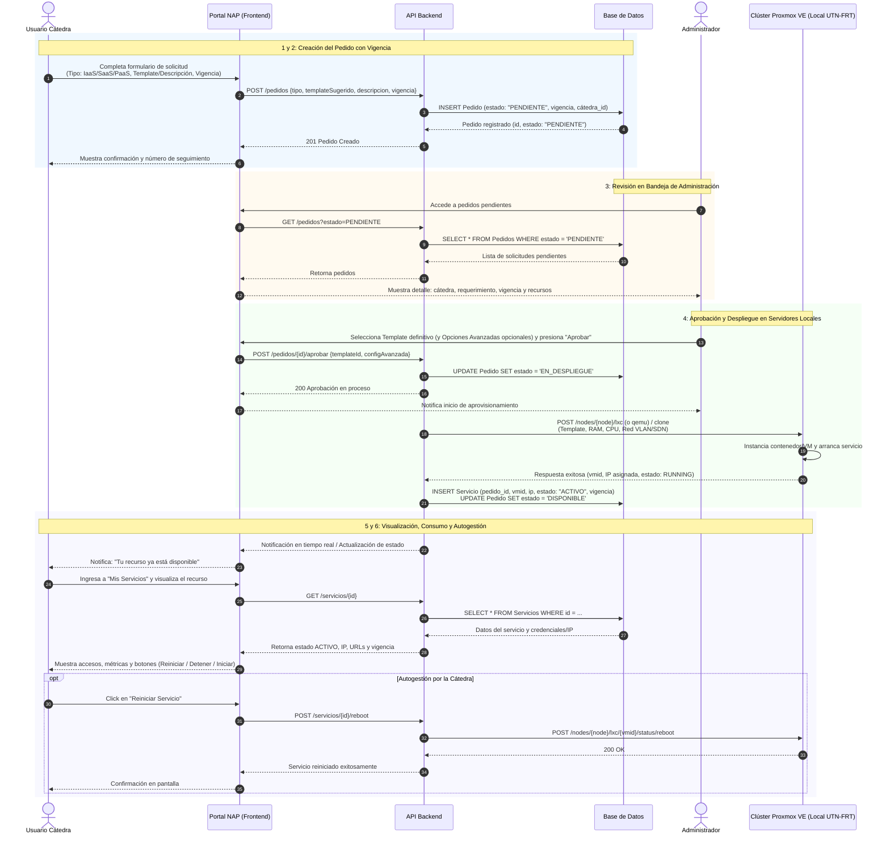
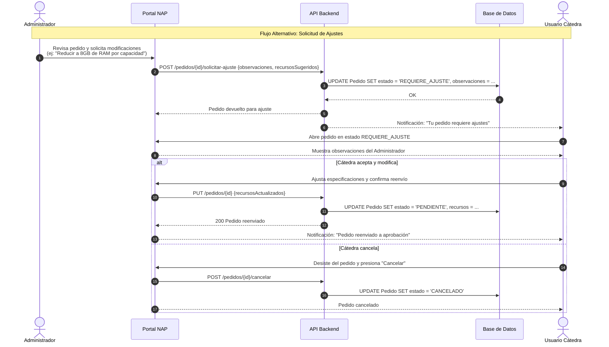
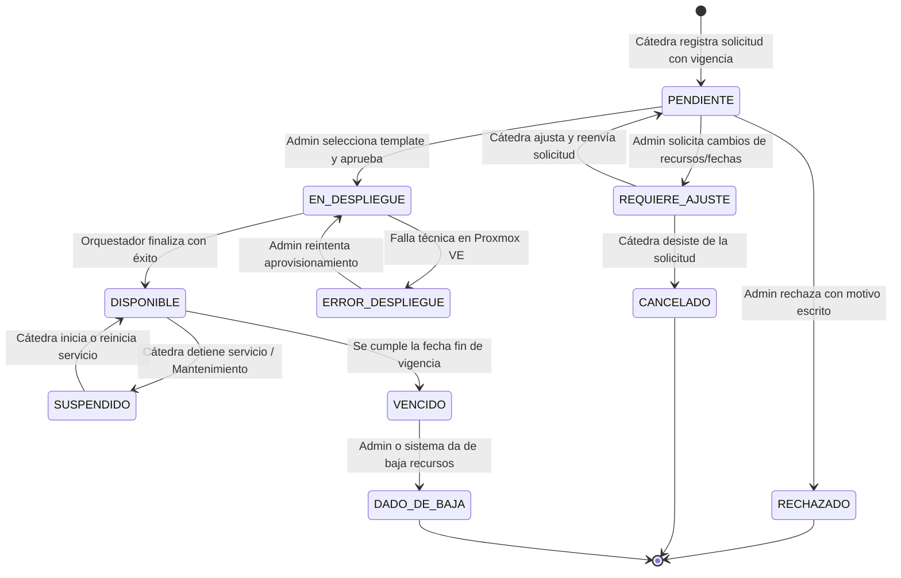

# Caso de Uso Principal: Solicitud y Aprovisionamiento de Recursos para Cátedras

## 1. Información General

| Campo | Detalle |
| :--- | :--- |
| **Identificador** | CU-01 |
| **Nombre** | Solicitud y Aprovisionamiento de Recursos de Infraestructura y Servicios (Happy Path y Variantes) |
| **Sistema** | Nube Académica Práctica (NAP) — UTN Facultad Regional Tucumán |
| **Actores** | **Usuario Cátedra** (Docente responsable de cátedra) **Administrador** (Operador de Infraestructura / TI de la NAP) **Sistema / Orquestador Proxmox VE** (Servidores locales UTN-FRT) |
| **Objetivo** | Permitir que una cátedra solicite recursos bajo demanda (IaaS, PaaS o SaaS) especificando su necesidad y vigencia, y que el Administrador evalúe la solicitud, asigne o ajuste la plantilla correspondiente y autorice el aprovisionamiento automatizado en el clúster local de Proxmox VE hasta dejarlo disponible para su consumo. |
| **Precondiciones** | 1. El usuario de cátedra cuenta con usuario activo y autenticado en el portal. 2. El sistema cuenta con templates preconfigurados gestionados por el Administrador (IaaS: Small, Medium, Large; SaaS/PaaS: servicios base). 3. El clúster local Proxmox VE dispone de conectividad y capacidad de cómputo/almacenamiento. |
| **Postcondiciones** | 1. El pedido queda registrado y en estado `DISPONIBLE`. 2. El contenedor/VM/servicio queda instanciado y operativo en la infraestructura local. 3. Se generan los datos de acceso (URL, IP, puerto o token de API) visibles para la cátedra en su panel. 4. La cátedra puede realizar acciones de autogestión (Iniciar, Detener, Reiniciar) y visualizar métricas de uso. 5. Queda registrada la trazabilidad y fecha de vigencia del servicio. |

---

## 2. Tipos de Servicios Soportados

1. **IaaS (Infraestructura como Servicio):**
   - Contenedores (LXC) y Máquinas Virtuales (VMs) sobre Proxmox VE.
   - Tamaños predefinidos mediante templates administrables (ej. *Small*, *Medium*, *Large* con vCPU, RAM y disco fijos).
   - El Administrador gestiona estos templates mediante un módulo ABM de plantillas.
2. **SaaS (Software como Servicio):**
   - Aplicaciones completas listas para usar (ej. Libro Virtual interactivo, Moodle, JupyterHub cátedra, herramientas de laboratorio).
   - La cátedra puede solicitar cualquier software o servicio institucional mediante descripción de requerimientos.
3. **PaaS (Plataforma como Servicio):**
   - Servicios y plataformas accesibles vía API (ej. APIs de inferencia de Inteligencia Artificial locales, bases de datos gestionadas PostgreSQL/MySQL).
   - Consumo directo mediante tokens o endpoints provistos por el sistema.

---

## 3. Flujo Principal (Happy Path)

1. **Selección y Configuración de la Solicitud:**
   - El Usuario Cátedra ingresa al portal de autoservicio y selecciona **Nuevo Pedido**.
   - Selecciona el tipo de servicio deseado (**IaaS**, **SaaS** o **PaaS**).
   - Para IaaS: selecciona el template base de recursos (*Small*, *Medium*, *Large*).
   - Para SaaS / PaaS: describe detalladamente el software o servicio requerido y los recursos estimados.
   - Indica la **vigencia requerida**: rango de fechas (desde/hasta), cuatrimestre académico o ciclo lectivo anual.
   - Envía el pedido.
2. **Creación y Registro del Pedido:**
   - El Sistema valida los campos obligatorios y persiste la solicitud con estado `PENDIENTE`.
   - El pedido queda disponible en la bandeja de gestión del Administrador.
3. **Revisión del Administrador:**
   - El Administrador visualiza el listado de pedidos pendientes en su consola.
   - Analiza los requerimientos técnicos, la vigencia solicitada y la disponibilidad de recursos en el clúster Proxmox VE.
   - Selecciona la plantilla de aprovisionamiento idónea (pudiendo consultar o modificar parámetros en la sección de *Opciones Avanzadas* si requiere personalización de red o almacenamiento).
4. **Aprobación y Aprovisionamiento:**
   - El Administrador confirma la **Aprobación**.
   - El Sistema actualiza el estado a `EN_DESPLIEGUE` y despacha la orden al orquestador del clúster local de Proxmox VE.
   - Proxmox VE clona la plantilla/contenedor/VM, asigna la red VLAN/SDN y levanta el servicio de forma automática.
   - Al finalizar, el orquestador retorna los datos de conexión (IP interna/externa, URL de acceso, credenciales o tokens de API).
5. **Puesta a Disposición y Notificación:**
   - El Sistema actualiza el estado del pedido a `DISPONIBLE` y asocia el nuevo `Servicio` activo a la cátedra solicitante.
   - Se notifica a la cátedra (vía notificación interna en el portal y/o correo institucional) informando que el recurso está listo para ser utilizado.
6. **Visualización y Autogestión por la Cátedra:**
   - El Usuario Cátedra ingresa a la sección **Mis Servicios** en el portal.
   - Visualiza el servicio en estado `ACTIVO / DISPONIBLE`, su fecha de vigencia y los datos de acceso (URL, IP y credenciales).
   - La cátedra puede distribuir los enlaces a sus alumnos (quienes consumen directamente la aplicación sin ingresar al portal NAP).
   - La cátedra dispone de controles de autogestión: **Iniciar**, **Detener**, **Reiniciar** y monitoreo de métricas de consumo (CPU, RAM, disco).

---

## 4. Diagrama de Secuencia: Happy Path

---

## 5. Flujos Alternativos y Excepciones

### Flujo Alternativo 1: Rechazo con Motivo Escrito (FA-01)
- **Condición:** El Administrador evalúa que la solicitud no es factible técnicamente, no cuenta con justificación suficiente o la infraestructura no dispone de capacidad para el período solicitado.
- **Acción:** El Administrador presiona **Rechazar**, ingresando obligatoriamente un **motivo por escrito**.
- **Resultado:**
  - El Sistema actualiza el estado del pedido a `RECHAZADO`.
  - Se registra el motivo en la base de datos.
  - La Cátedra recibe una notificación con la explicación del rechazo y puede consultar el motivo en el detalle del pedido.

### Flujo Alternativo 2: Solicitud de Ajustes / Contrapropuesta por el Administrador (FA-02)
- **Condición:** El Administrador considera viable la solicitud pero requiere ajustar recursos (ej: reducir memoria de 16 GB a 8 GB o ajustar fechas de vigencia) debido a restricciones de hardware.
- **Acción:** El Administrador no aprueba de inmediato ni rechaza; solicita modificaciones detallando las sugerencias o cambios requeridos.
- **Resultado:**
  - El pedido pasa al estado `REQUIERE_AJUSTE` (devuelto a la cátedra).
  - La Cátedra es notificada y visualiza las observaciones del Administrador en su panel.
  - La Cátedra decide:
    - **Aceptar cambios sugeridos:** Actualiza el pedido según lo indicado y lo reenvía a revisión (pasa nuevamente a `PENDIENTE`).
    - **Desestimar solicitud:** Cancela el pedido voluntariamente.

---

## 6. Diagrama de Estados: Ciclo de Vida del Pedido y Servicio

---

## 7. Mapeo a Próximos Casos de Uso a Definir

Conforme a las respuestas del relevamiento técnico, se desprenden los siguientes casos de uso para completar la especificación:

1. **CU-02: Gestión y ABM de Templates de Recursos (Administrador):**
   - Alta, baja, modificación y catalogación de plantillas para IaaS (*Small*, *Medium*, *Large*), PaaS y SaaS.
2. **CU-03: Gestión de Ajustes, Observaciones y Rechazos de Pedidos:**
   - Flujo de interacción entre Admin y Cátedra con historial de comentarios y versionado de cambios.
3. **CU-04: Monitoreo y Autogestión de Servicios Activos (Cátedra):**
   - Acciones de ciclo de vida (Start, Stop, Reboot) y visualización de métricas de carga en Proxmox.
4. **CU-05: Control de Vigencia, Renovación y Desaprovisionamiento:**
   - Alertas por proximidad de vencimiento (cuatrimestre/año), solicitud de prórroga y baja controlada de recursos.

---

## 8. Estado de Implementación y Trazabilidad

| Componente | Estado | Referencia Técnica |
| :--- | :--- | :--- |
| **Modelos y Schemas** | Implementado & Verificado | `backend/app/models/pedido.py`, `backend/app/schemas/pedido.py`, `backend/app/schemas/template.py` |
| **API Endpoints** | Implementado & Verificado | `backend/app/routers/pedidos.py`, `backend/app/routers/servicios.py`, `backend/app/routers/templates.py` |
| **Aprovisionamiento Proxmox** | Implementado & Verificado | `backend/app/services/orquestacion_service.py` con opciones avanzadas |
| **Validación de Capacidad** | Implementado & Verificado | Límite constitucional de 8 GB (`backend/app/services/limites_service.py`) |
| **Frontend UI** | Implementado & Verificado | `Pedidos.jsx`, `Servicios.jsx`, `Templates.jsx`, `NuevoPedidoModal.jsx`, `AprobarPedidoModal.jsx`, `TemplatesAdmin.jsx` |
| **Pruebas Automatizadas** | 318/318 Tests Pasando | Suite completa con tests e2e en `backend/tests/test_quickstart_e2e.py` |

