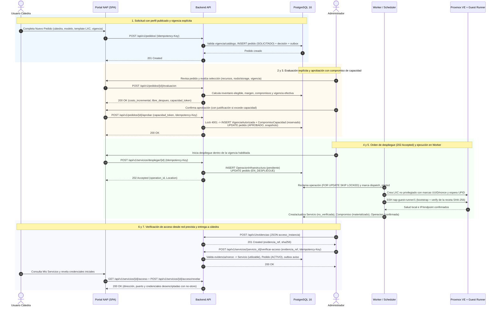
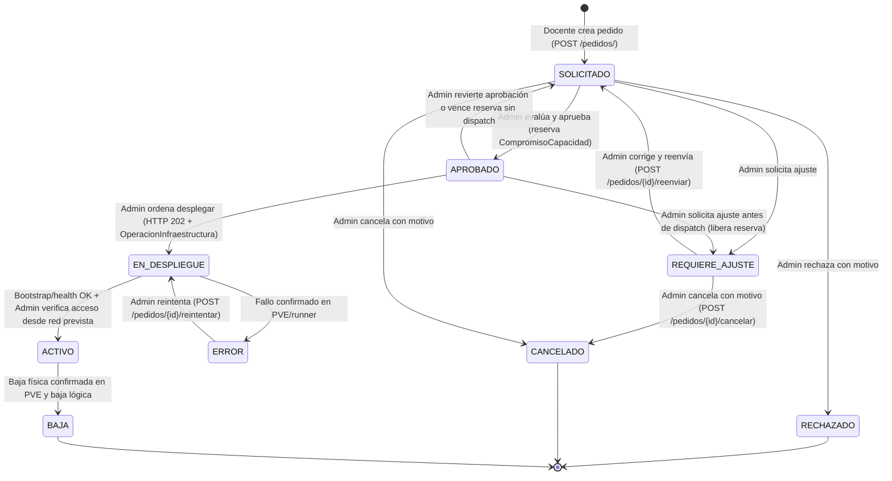

# Caso de Uso Principal: Solicitud y Aprovisionamiento de Recursos para Cátedras (Actualizado Feature 009)

## 1. Información General

| Campo | Detalle |
| :--- | :--- |
| **Identificador** | CU-01 |
| **Nombre** | Solicitud, Evaluación de Capacidad, Aprovisionamiento Asíncrono y Entrega Verificada de Recursos |
| **Sistema** | Nube Académica Práctica (NAP) — UTN Facultad Regional Tucumán |
| **Actores** | **Usuario Cátedra** (Docente responsable de una o varias cátedras) **Administrador** (Operador del portal / TI de la NAP) **Operador de Infraestructura / Runner** (Proxmox VE y `nap-guest-runner/1` sobre servidores UTN-FRT) |
| **Objetivo** | Permitir que un docente responsable solicite recursos bajo demanda (IaaS, PaaS o SaaS) seleccionando una oferta publicada y una vigencia académica o personalizada; que el Administrador evalúe explícitamente el costo contra la capacidad real del destino, comprometa el saldo y autorice el aprovisionamiento asíncrono de contenedores LXC en Proxmox VE; y que el servicio se entregue como utilizable una vez comprobado su funcionamiento y acceso desde la red prevista. |
| **Precondiciones** | 1. El usuario cuenta con sesión operativa activa (habiendo completado el cambio obligatorio de contraseña inicial y, si decidió activar 2FA voluntario, el desafío TOTP). 2. El sistema cuenta con definiciones de servicio validadas y publicadas (`linux`, `postgresql`, `bookstack`) y perfiles de recursos (`recurso_templates`) LXC compatibles. 3. Para vigencias académicas (`primer_cuatrimestre`, `segundo_cuatrimestre`, `anual`), el Administrador ha configurado el calendario lectivo del año solicitado. 4. El nodo Proxmox VE, el almacenamiento elegible y el wrapper SSH `nap-guest-runner/1` se encuentran accesibles. |
| **Postcondiciones** | 1. El compromiso de capacidad (`compromisos_capacidad`) queda materializado y vinculado a la identidad única del recurso (`identidades_infraestructura`). 2. El contenedor LXC no privilegiado queda instanciado, personalizado por receta verificada por SHA-256 y con salud local confirmada. 3. Tras registrar la evidencia de prueba desde la red prevista (`acceso_instancia`), el servicio pasa a disponibilidad `utilizable` y el pedido a estado `ACTIVO`. 4. El responsable de la cátedra puede consultar metadatos de acceso, revelar sus credenciales iniciales mediante acción auditada (`POST /servicios/{id}/acceso/revelar`), operar el ciclo de vida (`start`, `stop`, `restart`, `reactivar`, `renovar`) y consultar métricas e incidentes. 5. Toda decisión, transición y operación queda registrada de forma idempotente e inmutable en el historial. |

---

## 2. Modelos y Servicios Soportados en esta Entrega

En la entrega vigente se aprovisionan exclusivamente contenedores **LXC no privilegiados** (`tipo = 'lxc'`). Las referencias históricas a `qemu` se conservan en registros antiguos sin ofrecerse para nuevas solicitudes. No existen cuotas fijas por cátedra ni el tope artificial histórico de 8 GiB de disco: los recursos se gobiernan mediante los perfiles publicados por administración y la capacidad real del destino al aprobar.

1. **IaaS (Infraestructura como Servicio) — `linux`:**
   - Contenedor Ubuntu 24.04 LXC saneado (`linux-ubuntu-24.04-v1`) con cuenta local `napadmin` y acceso acotado a la consola nativa del contenedor propio en Proxmox VE (sujeto al gate institucional de identidades y revocación de consola).
2. **PaaS (Plataforma como Servicio) — `postgresql`:**
   - Contenedor Ubuntu 24.04 con **PostgreSQL 16** (`postgresql16-ubuntu-24.04-v1`), clúster de datos inicializado por instancia, autenticación SCRAM/TLS y base/usuario propios aislados de la base interna del portal NAP.
3. **SaaS (Software como Servicio) — `bookstack`:**
   - Contenedor Ubuntu 24.04 con **BookStack 26.09.1**, PHP 8.3 y MariaDB 10.11 (`bookstack26-ubuntu-24.04-v1`, referencia funcional provisional de publicación de contenidos). Entrega cuenta inicial docente para publicar libros/páginas y administrar cuentas individuales de solo lectura para alumnos dentro de la propia instancia BookStack (los alumnos no requieren cuentas en el portal NAP).

---

## 3. Flujo Principal (Happy Path)

1. **Creación de la Solicitud (`POST /api/v1/pedidos/`):**
   - El Usuario Cátedra abre **Nuevo Pedido** (el formulario se inicia limpio y coherente entre cátedra autorizada, modelo de servicio y perfil publicado).
   - Elige la cátedra propia, el modelo (`iaas`, `paas` o `saas`) y un perfil de recursos publicado compatible (`template_id`).
   - Completa la descripción de requerimientos y selecciona la vigencia:
     - **Académica:** `primer_cuatrimestre`, `segundo_cuatrimestre` o `anual` indicando `anio_lectivo` (muestra las fechas reales configuradas en `calendarios_lectivos`; nunca inventa 180 días si falta el período).
     - **Personalizada:** rango explícito `desde` / `hasta` (`YYYY-MM-DD`) válido en la zona institucional (`America/Argentina/Tucuman`).
   - Confirma el envío (con cabecera `Idempotency-Key`). El backend registra el pedido en estado `SOLICITADO`, registra la decisión idempotente y encola el aviso en el outbox transaccional (`notificaciones`).
2. **Evaluación Explícita de Capacidad (`POST /api/v1/pedidos/{id}/evaluacion`):**
   - El Administrador abre el pedido en su bandeja y revisa o ajusta la selección efectiva (`asignacion`, `destino` de nodo/storage y `vigencia`).
   - El sistema consulta el inventario elegible real, descuenta el margen del anfitrión, el consumo externo y los `compromisos_capacidad` abiertos, resuelve el intervalo `[inicio_at, fin_exclusivo_at)` y devuelve el costo incremental, el saldo antes/después, si excede capacidad y un `capacidad_token` ligado a las revisiones actuales.
3. **Aprobación y Compromiso Contable (`POST /api/v1/pedidos/{id}/aprobar`):**
   - El Administrador confirma la aprobación enviando la selección evaluada, el `capacidad_token` y, si excede capacidad física/lógica dentro de límites admisibles, una `justificacion_capacidad` escrita.
   - Bajo el advisory lock transaccional `4001`, el backend revalida el token, congela los snapshots (`asignacion_snapshot`, `destino_snapshot`, `decision_snapshot`), crea la `VigenciaAutorizada`, registra el `CompromisoCapacidad` en estado `reservado` y transiciona el pedido a `APROBADO`.
   - Si el inicio autorizado es futuro, la reserva se mantiene comprometida con vencimiento `min(fin_exclusivo_at, max(aprobado_at, inicio_at) + 24h)` y el despliegue permanece bloqueado (`esperando_inicio`) hasta que llegue la fecha inicial.
4. **Admisión del Despliegue Asíncrono (`POST /api/v1/servicios/desplegar/{pedido_id}`):**
   - Con el pedido aprobado y dentro de su vigencia habilitada, el Administrador ordena el despliegue (o utiliza `desplegar_inmediatamente: true` al aprobar un pedido cuya vigencia ya inició).
   - El backend crea la `OperacionInfraestructura` (`tipo: "desplegar"`, `estado: "pendiente"`), pasa el pedido a `EN_DESPLIEGUE` y responde inmediatamente **`202 Accepted`** con `Location: /api/v1/operaciones/{operation_id}`, sin bloquear el hilo HTTP ni anunciar éxito anticipado.
5. **Ejecución por el Worker y Personalización (`nap-guest-runner/1`):**
   - El worker reclama la operación con `FOR UPDATE SKIP LOCKED`, reclama/persiste la identidad VMID/UUID/nonce y, para aplicaciones, un destino del pool de red preautorizado; después persiste `dispatch_started` antes de invocar la API de Proxmox VE, clona/crea el contenedor LXC no privilegiado con las marcas de identidad y espera la tarea UPID.
   - Una vez iniciado el LXC, el worker genera y cifra los secretos únicos de la instancia y ejecuta `bootstrap` y `verify` a través de OpenSSH hacia la cuenta dedicada `naprunner` con protocolo cerrado `nap-guest-runner/1`.
   - Confirmada la salud local, el compromiso pasa a `materializado`, el servicio queda creado con `disponibilidad_aplicacion: "no_verificada"` y la operación de infraestructura cierra como `confirmada`.
6. **Verificación de Acceso desde Red Prevista (`POST /api/v1/evidencias` + `POST /api/v1/servicios/{id}/verificar-acceso`):**
   - El Administrador revela las credenciales en modo `solo_validacion`, comprueba el servicio desde un equipo de la red prevista (login/sudo en consola Linux, conexión y lectura/escritura en PostgreSQL, o publicación docente y lectura por alumno en BookStack), importa el documento JSON `acceso_instancia` en `POST /api/v1/evidencias` y confirma en `POST /api/v1/servicios/{id}/verificar-acceso`.
   - El servicio pasa a `disponibilidad_aplicacion: "utilizable"`, el pedido transiciona a `ACTIVO` y se encola la notificación de disponibilidad para la cátedra.
7. **Consumo y Autogestión por la Cátedra:**
   - El responsable de la cátedra consulta `GET /api/v1/servicios/{id}/acceso`, revela sus credenciales iniciales (`POST /api/v1/servicios/{id}/acceso/revelar`) y opera el servicio (`start`, `stop`, `restart`, `reactivar`, `renovar`) o consulta sus métricas e incidentes.

---

## 4. Diagrama de Secuencia: Solicitud, Aprobación, Despliegue Asíncrono y Entrega

---

## 5. Flujos Alternativos y Excepciones

### FA-01: Rechazo con Motivo Escrito (`POST /api/v1/pedidos/{id}/rechazar`)
- **Condición:** El requerimiento no es factible o carece de preparación soportada en el catálogo.
- **Acción:** El Administrador ejecuta el rechazo indicando un motivo obligatorio con `Idempotency-Key`.
- **Resultado:** El pedido pasa a `RECHAZADO`, se registra en `pedidos_historial` y se encola el aviso en el outbox.

### FA-02: Solicitud de Ajustes y Corrección/Reenvío Administrativo (`REQUIERE_AJUSTE`)
- **Condición:** El Administrador requiere adecuar el perfil, recursos o vigencia antes de aprobar (o revoca una aprobación aún no despachada).
- **Acción:**
  1. El Administrador ejecuta `POST /api/v1/pedidos/{id}/solicitar-ajuste` con observaciones obligatorias (si estaba `APROBADO` sin dispatch, libera atómicamente el compromiso y revoca la vigencia de esa revisión). El pedido pasa a `REQUIERE_AJUSTE`.
  2. El Usuario Cátedra visualiza las observaciones en su panel y acuerda los ajustes con administración por el canal institucional. **Por regla de autorización (`FR-003`, `A01`), el rol cátedra no puede reenviar ni cancelar pedidos (ni propios ni ajenos; recibe `403`).**
  3. El Administrador corrige y reenvía el pedido (`POST /api/v1/pedidos/{id}/reenviar`, recalculando o limpiando fechas incompatibles al cambiar la modalidad de vigencia) para devolverlo a `SOLICITADO`, o bien lo cancela con motivo (`POST /api/v1/pedidos/{id}/cancelar` -> `CANCELADO`).

### FA-03: Fallo o Resultado Incierto de Infraestructura y Reconciliación
- **Condición:** Una tarea Proxmox VE o llamada del runner falla o sufre un corte de transporte tras `dispatch_started`.
- **Resultado:**
  - Nunca se anuncia éxito anticipado ni se libera el `CompromisoCapacidad` si el recurso pudo haber quedado creado o encendido.
  - Si el resultado es desconocido, la operación queda `incierta` y el reconciliador periódico (`reconciliar_operaciones`) inspecciona Proxmox VE verificando `resource_uuid`, `nonce` y `pool` antes de adoptar el recurso propio o confirmar su ausencia.
  - Si el fallo es confirmado y recuperable, el pedido pasa a `ERROR` y el Administrador puede ejecutar `POST /api/v1/pedidos/{id}/reintentar` una vez verificada la ausencia o pertenencia del recurso.

### FA-04: Vencimiento, Renovación con Receso y Reactivación Sujeta a Capacidad
- **Condición:** Un servicio alcanza el `fin_exclusivo_at` de su vigencia actual (con o sin una renovación aprobada para un período futuro separado).
- **Resultado:**
  - El job de vencimientos ordena y confirma la detención en Proxmox VE antes de pasar el servicio a `PAUSED` y liberar el cómputo (`vcpus_retenidos = 0`, `ram_mb_retenida = 0`), manteniendo reservado el disco (`disk_bytes_retenidos`) y los datos.
  - Durante un receso entre dos períodos aprobados no se permite encender el servicio (`409 sin_cobertura_actual`).
  - Al iniciar el nuevo período autorizado, la cátedra o administración puede solicitar `POST /api/v1/servicios/{id}/reactivar`, que verifica capacidad disponible bajo el lock `4001`; si no hay cómputo libre en ese instante, devuelve `409 sin_capacidad`, conserva el servicio pausado y permite reintentar dentro de la vigencia.

---

## 6. Diagrama de Estados: Pedido y Servicio

---

## 7. Estado de Implementación y Trazabilidad (Feature 009)

| Componente | Estado | Referencia Técnica |
| :--- | :--- | :--- |
| **Modelos y Esquema Final** | Implementado & Verificado (`009_14`) | `backend/app/models/`, `docs/diagrama_bd.md`, `backend/alembic/versions/009_13_cierre_constraints.py`, `009_14_restauracion.py` |
| **Autorización, Sesión y 2FA Opcional** | Implementado & Verificado | `backend/app/routers/auth.py`, `backend/app/services/auth_service.py`, `backend/app/services/acceso_service.py` |
| **Evaluación y Ledger de Capacidad** | Implementado & Verificado (sin tope de 8 GB ni cuotas fijas) | `backend/app/services/admision_service.py`, `backend/app/services/capacidad_service.py`, `backend/app/models/compromiso_capacidad.py` |
| **Operaciones 202, Identidad y Runner** | Implementado & Verificado | `backend/app/services/operacion_service.py`, `backend/app/services/preparacion_service.py`, `infra/runner/nap_guest_runner.py` |
| **Calendario, Vigencias y Recesos** | Implementado & Verificado | `backend/app/services/vigencia_service.py`, `backend/app/services/vencimiento_service.py` |
| **Observabilidad, Deltas e Incidentes** | Implementado & Verificado | `backend/app/services/metricas_service.py`, `backend/app/services/resumen_metricas_service.py`, `backend/app/services/alerta_service.py` |
| **Frontend SPA y Accesibilidad** | Implementado & Verificado | `frontend/src/pages/Pedidos.jsx`, `Servicios.jsx`, `Metricas.jsx`, `Definiciones.jsx`, `Calendario.jsx` |
| **Suites Automatizadas de Cierre (T134)** | **666 Backend + 99 PG + 130 Infra + 41 Vitest + 21 E2E Pasando** | `docs/evidencia/009/regresion-cierre.md` |

En la convergencia, el worker conserva el snapshot del destino preparado y su MAC de DHCP antes de crear. Una pausa automática confirmada transiciona el pedido a SUSPENDIDO; una reactivación confirmada lo devuelve a ACTIVO, con historia idempotente. La habilitación de consola requiere evidencia aplicable a la instalación y scopes individuales, no un archivo de staging. Véase [contrato de conexión](../../conexion-infraestructura.md).
