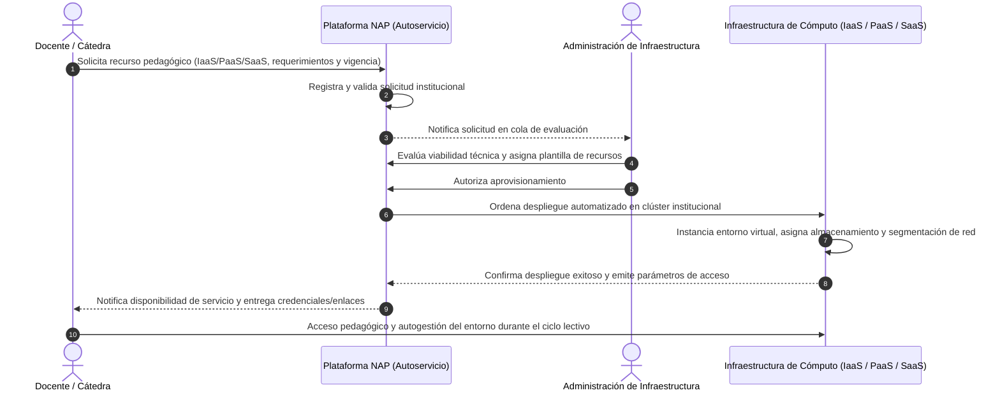

# Modelo de Interacción y Aprovisionamiento Bajo Demanda (NAP)
## Documentación Conceptual para Artículo Académico / Congreso

El presente documento describe el modelo de interacción del caso de uso principal de la **Nube Académica Práctica (NAP)**, estructurado con un nivel de abstracción conceptual apto para su incorporación en publicaciones académicas y congresos de ciencias de la computación y educación en ingeniería.

---

### Figura: Flujo de interacción y ciclo de aprovisionamiento de servicios bajo demanda

---

### Descripción y Fundamentación Académica para el Artículo

#### 1. Contexto y Principio de Autoservicio
En concordancia con la definición estándar de computación en la nube del **NIST (SP 800-145)**, la Nube Académica Práctica implementa la característica esencial de **autoservicio bajo demanda** (*on-demand self-service*), moderado por una gobernanza centralizada. El modelo de interacción formaliza el ciclo mediante el cual los docentes responsables de cátedra solicitan y obtienen recursos computacionales sin requerir intervención manual compleja por parte del personal de infraestructura.

#### 2. Etapas del Flujo de Interacción

1. **Definición de Requerimientos y Solicitud Docente:**  
   El docente ingresa a la plataforma institucional y especifica el modelo de servicio adecuado a los objetivos pedagógicos de la asignatura:
   - **IaaS:** Dimensionamiento de capacidad computacional base (máquinas virtuales o contenedores para prácticas avanzadas de virtualización, sistemas operativos o redes).
   - **PaaS:** Entornos de ejecución y APIs especializadas (e.g., endpoints locales de inferencia para Inteligencia Artificial o motores de bases de datos compartidos).
   - **SaaS:** Aplicaciones y plataformas interactivas listas para su uso en el aula (e.g., entornos JupyterHub o libros virtuales).  
   Asimismo, se define la **vigencia temporal** del servicio (cuatrimestre o ciclo lectivo), garantizando el principio de elasticidad y rotación eficiente de los recursos físicos limitados.

2. **Gobernanza y Validación de Viabilidad:**  
   La solicitud ingresa en un estado de espera supervisada. El equipo de administración de infraestructura evalúa el impacto del pedido sobre la capacidad global del clúster local, garantizando la equidad entre cátedras y el cumplimiento de las políticas de alta disponibilidad. En este punto, el administrador vincula la solicitud con una **plantilla institucional homologada** (*template*), lo que asegura reproducibilidad, seguridad y homogeneidad operativa.

3. **Orquestación y Despliegue Desatendido:**  
   Una vez autorizada la solicitud, la plataforma delega de manera automatizada la instanciación de los recursos al clúster de virtualización on-premise. Este proceso comprende:
   - La clonación ágil de la plantilla seleccionada.
   - La asignación de memoria, procesamiento y almacenamiento sobre el almacenamiento centralizado compartido.
   - El aislamiento lógico de tráfico mediante redes definidas por software (SDN) y VLANs dedicadas por cátedra (*tenant isolation*).

4. **Entrega, Autogestión y Consumo Pedagógico:**  
   La plataforma actualiza el estado del recurso a disponible y emite al docente los canales de acceso (enlaces, puertos y parámetros de autenticación). El docente puede distribuir los accesos a los estudiantes de su comisión, quienes consumen directamente el servicio en sus actividades prácticas. A su vez, el docente cuenta con capacidades de **autogestión supervisada** (arranque, detención, reinicio y monitoreo del estado operativo), otorgando autonomía a la cátedra mientras se preserva la integridad del clúster.

#### 3. Impacto en la Sostenibilidad y Soberanía Institucional
Este esquema mitiga la dispersión de servidores en laboratorios físicos departamentales, reduce drásticamente los tiempos de preparación de entornos docentes (de semanas a minutos) y maximiza la tasa de utilización del equipamiento propio de la Facultad, sustentando un modelo tecnológico reproducible, seguro y soberano.

