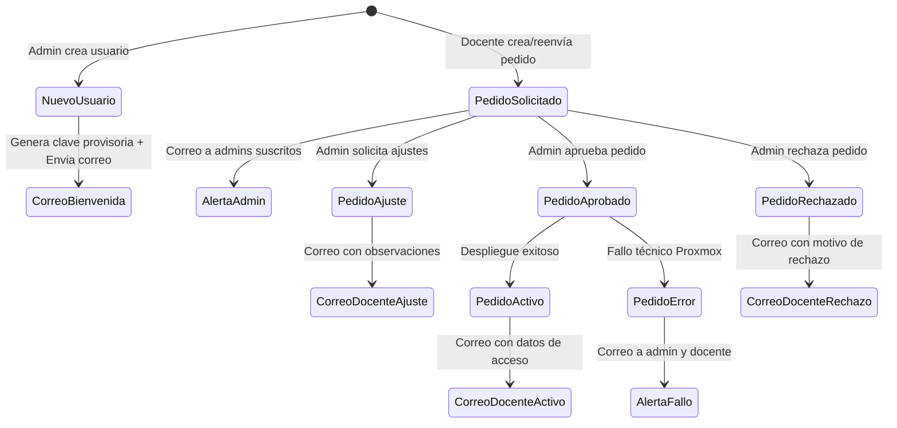

# Data Model: Notificaciones por Email y Gestión de Contraseñas Provisorias

**Feature Branch**: `008-notificaciones-email-usuarios-pedidos`  
**Date**: 2026-10-11  
**Spec**: [spec.md](./spec.md)

---

## 1. Entidades Modificadas

### Entidad: `Usuario` (tabla `usuarios`)

Representa las credenciales y el perfil de las personas autorizadas en el portal.

#### Campos Agregados

| Campo | Tipo | Nulo | Default | Descripción |
|---|---|---|---|---|
| `debe_cambiar_password` | `Boolean` | `False` | `False` | Indica si el usuario debe actualizar su contraseña obligatoriamente tras el inicio de sesión. Al crearse vía admin se establece en `True`. |
| `recibir_notificaciones_email` | `Boolean` | `False` | `True` | Permite a los administradores optar por recibir o no las alertas por correo electrónico sobre pedidos y estado de infraestructura. |

#### Reglas de Validación
1. **Email obligatorio en alta**: En la creación de usuarios, `email` no puede ser nulo ni vacío, y debe tener un formato de correo electrónico válido.
2. **Cátedras mínimas**: Si el rol es `catedra_admin`, debe tener al menos una cátedra asignada (regla preexistente validada).
3. **Contraseña provisoria**: Debe ser generada con un mínimo de 10 caracteres criptográficamente seguros.
4. **Nueva contraseña**: Al realizar el primer cambio, la nueva contraseña debe tener como mínimo 8 caracteres.

---

## 2. Configuración del Sistema (`Settings` en `app/config.py`)

Nuevas variables de entorno para soportar el transporte SMTP:

| Variable | Tipo | Default | Descripción |
|---|---|---|---|
| `SMTP_HOST` | `str` | `""` | Servidor SMTP institucional (ej: `smtp.frt.utn.edu.ar` o `smtp.gmail.com`). |
| `SMTP_PORT` | `int` | `587` | Puerto del servidor SMTP (587 para TLS / STARTTLS, 465 para SSL). |
| `SMTP_USER` | `str` | `""` | Usuario de autenticación en el servidor SMTP. |
| `SMTP_PASSWORD` | `str` | `""` | Contraseña o token de aplicación para SMTP. |
| `SMTP_FROM` | `str` | `"noreply@frt.utn.edu.ar"` | Dirección de origen mostrada en el encabezado `From:`. |
| `SMTP_TLS` | `bool` | `True` | Indica si se debe iniciar STARTTLS. |
| `SMTP_SSL` | `bool` | `False` | Indica si se debe utilizar conexión SSL directa. |
| `APP_FRONTEND_URL` | `str` | `"http://localhost:5173"` | URL base pública de la interfaz para componer enlaces en los correos. |

---

## 3. Modelo Lógico de Notificación por Correo

Estructura de datos en memoria para el despacho de correos en `app/services/email_service.py`:

```python
class MensajeEmail:
    destinatarios: list[str]
    asunto: str
    cuerpo_texto: str
    cuerpo_html: str
```

### Eventos de Notificación



